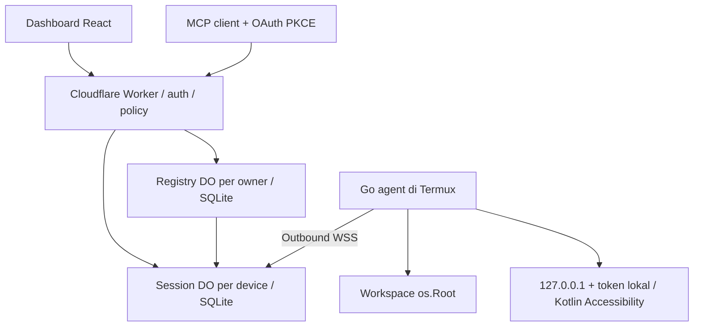

# Arsitektur

Satu Worker berisi entry gateway, OAuth library resmi, dan dua kelas DO. Registry menyimpan device index, pairing hash sekali pakai, session hash, client token hash, workflow, dan audit. Device session menyimpan job dan WebSocket Hibernation. Tidak ada enumerasi global DO.

Dashboard dan bundle statis dikemas menjadi modul Worker melalui `scripts/embed-dashboard.mjs`. Ini memungkinkan deployment artefak tunggal melalui API Cloudflare serta Wrangler tanpa CDN atau origin tambahan.

Job disimpan sebelum dikirim. `waiting_approval → waiting_device → dispatched → acknowledged → completed/failed`. State terminal meliputi completed/failed/cancelled/expired. `dispatched` tidak kembali menjadi `waiting_device`; reconnect tidak mengulang side effect ambigu. Agent membuat journal sebelum ACK dan menulis hasil sebelum mengirimnya. Setelah server ACK, journal menjadi tombstone. Jurnal dibatasi 10.000 file dan agent menolak start jika batas terlewati; tidak menghapus bukti eksekusi diam-diam.

Workflow disimpan per owner. Alarm registry mengirim satu langkah, menunggu hasil, lalu melanjutkan. Langkah gagal/expired/cancelled menghentikan run. Scope client diperiksa lagi untuk setiap langkah. Hanya terminal allowlist serta file list/read yang dapat menjadi langkah workflow rilis ini.

Batas awal: 50 perangkat termasuk yang dicabut; 50 job aktif per perangkat; riwayat 100 job per query perangkat; dashboard maksimum 200 job; hasil berumur tujuh hari; 2.000 audit events terbaru. Ini batas aplikasi awal, bukan batas Cloudflare atau klaim SLO.
